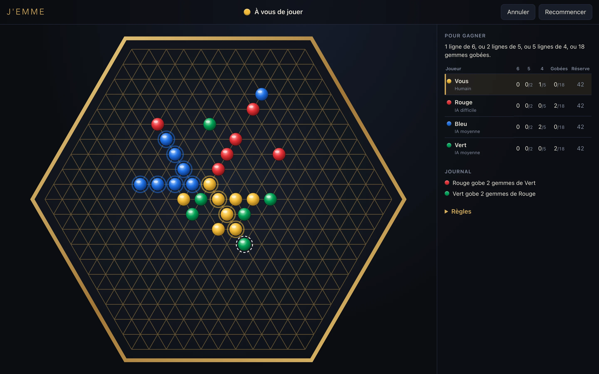
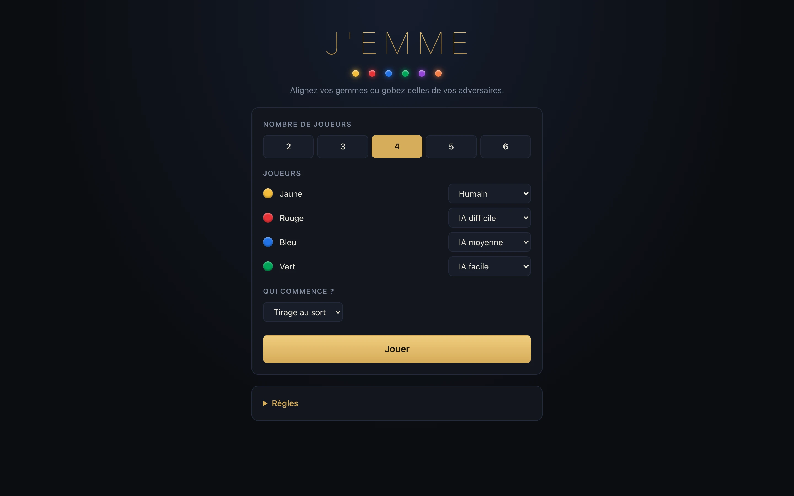
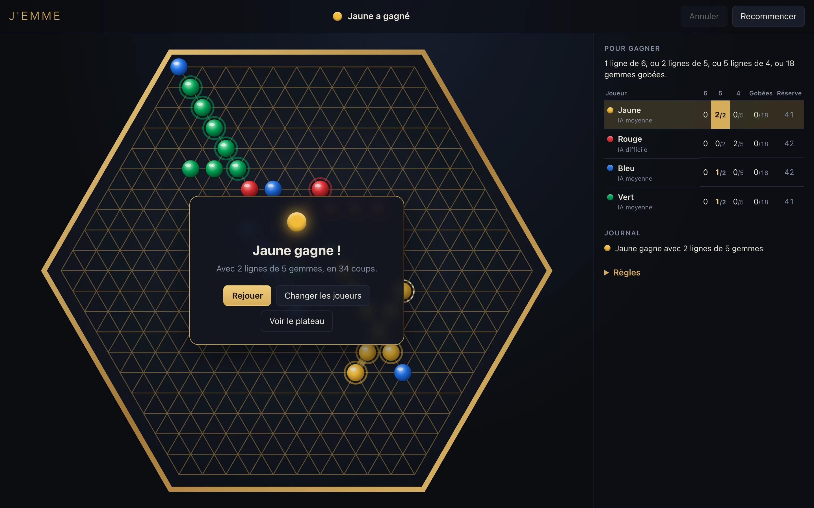

<div align="center">

# J'emme

**Alignez vos gemmes, ou gobez celles de vos adversaires.**

Adaptation numérique du jeu de société *J'emme* : de 2 à 6 joueurs, humains ou IA, dans le navigateur.




</div>

## Fonctionnalités

- **De 2 à 6 joueurs**, chacun humain ou IA (facile, moyenne ou difficile), sur un même écran.
- **Le plateau du jeu** : un hexagone de 331 intersections sur une grille triangulaire.
- **Aide visuelle** : au survol, une gemme fantôme montre le coup et les gemmes qui seraient gobées
  clignotent. Les lignes qui comptent pour la victoire sont entourées.
- **Suivi de partie** : tableau des objectifs par joueur, journal des captures, ligne gagnante mise
  en évidence.
- **Annuler** revient à votre coup précédent, même si des IA ont joué entre-temps.
- **IA dans un Web Worker** : l'interface reste fluide pendant qu'elle réfléchit (1,8 s au plus).
- **Utilisable sur mobile**, le temps qu'une vraie application voie le jour.

## Démarrer

Il faut [Node.js](https://nodejs.org/) 22 ou plus récent.

```bash
git clone git@github.com:juliennoel9/jemme.git
cd jemme
npm install
npm run dev
```

Le jeu s'ouvre sur <http://localhost:5180>.

| Commande          | Rôle                                        |
| ----------------- | ------------------------------------------- |
| `npm run dev`     | Serveur de développement                    |
| `npm test`        | Tests du moteur de règles et de l'IA        |
| `npm run build`   | Vérification des types et build de production dans `dist/` |
| `npm run preview` | Sert le build de production                 |

## Règles du jeu

D'après la [notice officielle](https://www.lansay.fr/sites/default/files/2023-09/75100%20NOTICE.pdf).

**Un tour.** Chaque joueur pose une gemme sur l'intersection libre de son choix, bords compris.
Chaque intersection est sur 3 lignes.

**Gober.** Posez une gemme qui encadre exactement **2** gemmes d'un même adversaire, côte à côte sur
une ligne : elles sont gobées. Un seul coup peut gober plusieurs paires. Poser sa gemme entre deux
gemmes adverses ne fait pas gober.

**Gagner.** Le premier qui remplit l'une de ces conditions l'emporte :

| Joueurs            | 2  | 3  | 4  | 5  | 6  |
| ------------------ | -- | -- | -- | -- | -- |
| Ligne de 6         | 1  | 1  | 1  | 1  | 1  |
| *ou* lignes de 5   | 3  | 3  | 2  | 2  | 2  |
| *ou* lignes de 4   | 8  | 6  | 5  | 4  | 4  |
| *ou* gemmes gobées | 24 | 20 | 18 | 14 | 12 |

Précisions retenues, là où la notice ne dit rien :

- Une ligne compte uniquement pour sa longueur exacte : une ligne de 5 n'est pas une ligne de 4, et 7
  gemmes ou plus comptent comme une ligne de 6.
- Les lignes se comptent sur le plateau tel qu'il est : une ligne coupée par une capture ne compte plus.
- Chaque joueur a 50 gemmes, et les gemmes gobées restent à celui qui les a gobées. Un joueur sans
  gemme passe son tour ; si plus personne ne peut jouer, la partie est nulle.

## L'IA

| Niveau    | Comportement                                                                 |
| --------- | ---------------------------------------------------------------------------- |
| Facile    | Juge chaque coup isolément, avec une bonne part de hasard. Oublie souvent de bloquer. |
| Moyenne   | Regarde la réponse du joueur suivant : pare les menaces, saisit les captures. |
| Difficile | Calcule plusieurs coups à l'avance dans le temps imparti (1,8 s au plus).    |

- **À 2 joueurs** : minimax avec élagage alpha-bêta.
- **À plus de 2** : recherche max-n, où chacun joue pour soi dans l'ordre réel du tour. Une IA laisse
  le joueur placé juste avant un adversaire menaçant parer la menace s'il s'agit d'une IA moyenne ou
  difficile ; si c'est un humain ou une IA facile, elle pare elle-même.

Les réglages ont été ajustés en faisant jouer les IA entre elles par centaines de parties. Sur les
séries de test, de 3 à 6 joueurs, aucune partie n'a fini nulle, et un niveau supérieur gagne bien plus
souvent que les autres.
Par exemple, une IA difficile gagne 75 % de ses parties contre deux IA moyennes, là où le hasard en
donnerait 33 %.

## Architecture

```
src/
├── engine/           Moteur en TypeScript pur, sans dépendance au navigateur
│   ├── board.ts      Géométrie du plateau : coordonnées axiales, voisins, lignes
│   ├── rules.ts      État de partie, pose, captures, comptage des lignes, victoire
│   ├── ai.ts         IA (évaluation rapide, recherche, niveaux)
│   └── *.test.ts     Tests Vitest
└── ui/               Interface React, plateau en SVG
    ├── Game.tsx      Déroulement de la partie, scores, journal
    ├── Board.tsx     Plateau, gemmes, animations
    ├── Setup.tsx     Choix des joueurs
    └── ai.worker.ts  L'IA dans un Web Worker
```

Le moteur ne sait rien de l'affichage : il pourra être réutilisé tel quel dans une application
mobile.

## Aperçu

<table>
  <tr>
    <td></td>
    <td></td>
  </tr>
  <tr>
    <td align="center">Choix des joueurs</td>
    <td align="center">Fin de partie</td>
  </tr>
</table>

## Feuille de route

- [x] Prototype jouable sur ordinateur, contre des IA de 3 niveaux
- [ ] Application mobile iOS et Android (React Native avec Expo, en réutilisant `src/engine/`)
- [ ] Commandes tactiles : zoom sur le plateau, toucher pour prévisualiser puis valider
- [ ] Nom et visuels propres avant toute publication sur les stores

## Mentions

Projet personnel et non officiel. *J'emme* est un jeu de Cyril Jouhannet édité par
[Lansay](https://www.lansay.fr/) ; le nom du jeu lui appartient. Le plateau et les gemmes de cette
version sont dessinés de zéro.
